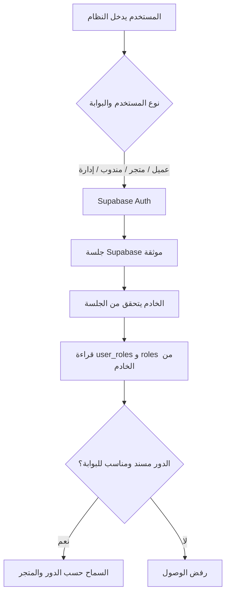
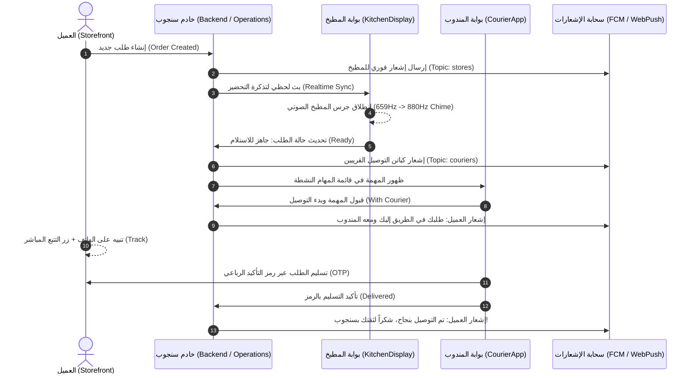

# وثيقة بيانات المصادقة والربط على سوبابيز وخريطة الإشعارات — منظومة سنجوب 2026
**تاريخ التوثيق:** نوفمبر 2026  
**حالة المشروع:** ما قبل الإطلاق؛ لا توجد حسابات تشغيلية أو بيانات إنتاج يجب ترحيلها من Firebase.  
**حالة التوثيق:** مرجع الإعدادات المعتمد، قورن بقاعدة Supabase الحية في 6 نوفمبر 2026.

---

## 1. بيانات الربط والاعتماد لمشروع Supabase

### 1.1 بيانات الاتصال والمفاتيح (Configuration)
| المفتاح / المعلمة | القيمة المعتمدة | الاستخدام |
| :--- | :--- | :--- |
| **Supabase Project Ref** | `tvnsqatkaqyubeznhnmu` | المعرف الفرعي للمشروع على سحابة سوبابيز |
| **Supabase URL** | `https://tvnsqatkaqyubeznhnmu.supabase.co` | الرابط الأساسي لواجهات الـ REST والـ Realtime |
| **Anon Public Key** | `sb_publishable_9ORqYV9HK0AbacKtYSRZiA_K7hcJ4yI` | المفتاح العام للاستعلام الآمن ومصادقة المتصفح |
| **Cloudflare R2 Bucket** | `sangoub` | مستودع الصور السحابي لكتالوج المنتجات والمتاجر والملفات |
| **R2 Public Base URL** | `https://pub-39e754c2871845ba91c1ec271a0400e8.r2.dev` | النطاق السحابي العام لعرض صور الكتالوج |

---

## 2. هندسة المصادقة والحسابات (Authentication Architecture)

تسجيل الدخول للمستخدمين والبوابات يتم عبر **Supabase Auth**. يتحقق الخادم من الجلسة، ويقرأ أدوار `user_roles` المرتبطة بجدول `roles`. بيانات المتصفح وبيانات `user_metadata` ليست مصدراً لمنح الصلاحيات. تُنشأ حسابات الموظفين بدعوة Supabase، وتُسند الأدوار من الخادم. Firebase مخصص للإشعارات فقط؛ يجب إزالة Firestore وFirebase Auth وFirebase Storage من بقية التطبيق. تُحفظ صور الملفات والكتالوج في Cloudflare R2.



**حالة إنشاء الحسابات:** واجهة إدارة الحسابات تستخدم Supabase Auth و`profiles` و`user_roles`. إنشاء الحساب يرسل دعوة آمنة لتعيين كلمة المرور. لا تستخدم جلسات `sys_` أو ملفات كلمات مرور محلية. المشروع ما زال قبل الإطلاق، وسجل الحسابات القديم ليس مصدر ترحيل.

---

## 3. دليل الحسابات الرسمية للمنظومة (System Accounts Directory)

الأسماء أدناه من سجل قديم وليست دليلاً على وجود حسابات Supabase فعالة. لا تتضمن هذه الوثيقة كلمات مرور. فحص قاعدة البيانات الحالية وجد 4 مستخدمين في Auth و5 تعيينات أدوار (مشرفان عامان وثلاثة عملاء)، دون تعيينات متجر أو مندوب.

### 3.1 حساب الإدارة العامة (Admin)
* **الاسم:** مدير المنظومة (المشرف العام) — Mesk LLC
* **البريد الإلكتروني:** `meskllcqa@gmail.com`
* **رقم الهاتف:** `01222334455`
* **الدور (Role):** `admin`
* **رابط البوابة:** `http://localhost:3000/admin`

---

### 3.2 حسابات المتاجر والمطابخ الشريكة (Merchants & Kitchens)
*رابط الدخول الموحد لجميع المتاجر:* `http://localhost:3000/merchant`  

| اسم المسؤول والمنشأة | البريد الإلكتروني المعتمد | المتجر المسند | معرف المتجر في سوبابيز (UUID) |
| :--- | :--- | :--- | :--- |
| **إبراهيم هنداوي (مطعم فول هند)** | `hind.foul@gov-foodcourt.eg` | مطعم وفول هند | `27d12743-8106-4ef0-ba3c-84abefdb75d6` |
| **سمير قطب (بيتزا روما)** | `samir.pizza@gov-foodcourt.eg` | بيتزا روما | `27d12743-8106-4ef0-ba3c-84abefdb75d6` |
| **ياسر عبد ربه (برجر فاكتوري)** | `yasser.burger@gov-foodcourt.eg` | برجر فاكتوري | `27d12743-8106-4ef0-ba3c-84abefdb75d6` |
| **طارق البدري (شاورما أبو طارق)** | `tarek.shawarma@gov-foodcourt.eg` | شاورما أبو طارق | `27d12743-8106-4ef0-ba3c-84abefdb75d6` |
| **حسام نصر (عصائر فريش تايم)** | `hossam.juice@gov-foodcourt.eg` | عصائر ومشروبات | `55508f0e-f818-452e-b946-ab803fe9d637` |
| **منى زهران (حلواني العبد)** | `mona.sweets@gov-foodcourt.eg` | حلويات ومخبوزات | `55508f0e-f818-452e-b946-ab803fe9d637` |
| **مجدي خليل (سوبرماركت النخبة)** | `magdy.market@gov-foodcourt.eg` | سوبرماركت النخبة | `54a6c2f6-6c29-4177-ac65-32fadddea83d` |
| **د. نور الدين (صيدلية العاصمة)** | `nour.pharmacy@gov-foodcourt.eg` | صيدلية العاصمة 24/7 | `b1111111-2222-3333-4444-555555555501` |
| **محمود الشريف (كافيه الحي الحكومي)**| `mahmoud.coffee@gov-foodcourt.eg`| كافيه الحي الحكومي | `55508f0e-f818-452e-b946-ab803fe9d637` |
| **السيد متولي (مخبز الحي الحكومي)** | `sayed.bakery@gov-foodcourt.eg` | مخبز الحي الحكومي | `55508f0e-f818-452e-b946-ab803fe9d637` |

---

### 3.3 حسابات كباتن التوصيل (Couriers Fleet)
*رابط البوابة المباشرة:* `http://localhost:3000/courier`  

| اسم الكابتن واللقب | البريد الإلكتروني | الهاتف | المركبة ورقم اللوحة |
| :--- | :--- | :--- | :--- |
| **أحمد رجب (كابتن النسر)** | `ahmed.rajab@delivery.gov.eg` | `01099887766` | دايون 4 (س ع ق 1 9 4) |
| **كريم ممدوح (كابتن الصقر)** | `kareem.mamdouh@delivery.gov.eg` | `01122334455` | هوجان F250 (ر ط ب 8 2 1) |
| **حسام فوزي (كابتن السريع)** | `hossam.fawzy@delivery.gov.eg` | `01233445566` | بينيللي TNT 150 (ن ل م 3 5 7) |
| **طارق العوضي (كابتن الفهد)** | `tarek.awady@delivery.gov.eg` | `01544556677` | ياماها XTZ (ص ق هـ 4 6 8) |
| **إسلام عزب (كابتن السهم)** | `islam.azab@delivery.gov.eg` | `01011223344` | بوكسر باجاج (ف و ي 9 1 3) |

---

## 4. هيكلية وربط بيانات سوبابيز (Supabase Schema & Entity Mapping)

### 4.1 الجداول الرئيسية المستعملة (Database Tables)
1. **جدول `stores` (بيانات المتاجر والمطابخ):**
   - الحقول: `id (UUID)`, `name`, `name_en`, `category`, `status`, `delivery_time`, `min_order`, `delivery_fee`, `location_in_district`, `logo_url`, `banner_url`, `commission_rate`, `tax_rate`.
2. **جدول `products` (كتالوج الأصناف والوجبات):**
   - الحقول: `id (UUID)`, `store_id (UUID)`, `name`, `name_en`, `description`, `price`, `original_price`, `image_url`, `is_available`, `category`, `options (JSONB)`.
3. **جدول `profiles` (الملفات الشخصية للعملاء وموظفي الوزارات):**
   - الحقول: `id (UUID matching auth.uid)`, `full_name`, `email`, `phone`, `role`, `ministry`, `floor_number`, `room_number`, `wallet_balance`, `avatar_url`.
4. **جدولا `user_roles` و`roles` (مصدر صلاحيات الحسابات):**
   - التعيينات تربط المستخدم بالدور والمتجر. لم يظهر جدول `store_memberships` في قاعدة البيانات الحية.

### 4.2 جدول مطابقة أسماء المتاجر إلى معرفات Supabase الرسمية:
```typescript
export const STORE_SLUG_TO_SUPABASE_UUID: Record<string, string> = {
  'sangoub-market': 'a0000000-0000-0000-0000-000000000001', // متجر سنجوب المركزي
  'capital-pharmacy': 'b1111111-2222-3333-4444-555555555501', // صيدلية العاصمة 24/7
  'capital-falafel': '27d12743-8106-4ef0-ba3c-84abefdb75d6', // فول وفلافل العاصمة
  'store-foul-hind': '27d12743-8106-4ef0-ba3c-84abefdb75d6', // مطعم فول هند
  'government-cafe': '55508f0e-f818-452e-b946-ab803fe9d637', // كافيه الحي الحكومي
  'store-cafe-gov': '55508f0e-f818-452e-b946-ab803fe9d637',
  'store-supermarket-el-nokba': '54a6c2f6-6c29-4177-ac65-32fadddea83d', // سوبرماركت النخبة
};
```

---

## 5. الخريطة المستهدفة ودورة حياة الإشعارات

> هذا مخطط التشغيل المستهدف؛ لا يعني أن كل محفز تلقائي أو قناة ويب قد اكتمل. سجل الحملات ورموز الأجهزة وصندوق المستخدم تحفظ الآن في Supabase. Firebase Admin مخصص لإرسال FCM، وملفات الصور على Cloudflare R2. إشعارات مراحل الطلب، Push الويب، والنوافذ التسويقية المجدولة ما زالت مراحل تنفيذ لاحقة.

تعمل الإشعارات في سنجوب عبر **3 طبقات متكاملة** لضمان عدم ضياع أي طلب:



---

### 5.1 الطبقة الأولى: الإشعارات الصوتية اللحظية للمطابخ (Web Audio Chime)
- **الموقع:** [`src/components/KitchenDisplay.tsx`](file:///d:/Sangoub/src/components/KitchenDisplay.tsx)
- **الميكانيزم:** توليد نغمة ثنائية رقمية نقية بواسطة Web Audio API بدون أي ملفات خارجية معرضة للتلف:
  - النغمة الأولى: `659.25 Hz` (E5) لمدة 120ms
  - النغمة الثانية: `880.00 Hz` (A5) لمدة 200ms
- **المحفز:** فور استلام طلب جديد في طابور تحضير المتجر (`preparationQueue`).
- **خيارات التحكم:** زر مدمج لكتم الصوت أو تفعيله مع نغمة اختبار تأكيدية.

---

### 5.2 الطبقة الثانية: إشعارات Push عبر FCM
- **نقطة النهاية بالخادم:** [`server/handlers/notifications.ts`](file:///d:/Sangoub/server/handlers/notifications.ts) عبر `POST /api/notifications`.
- **تخزين البيانات:** `notification_campaigns` و`notification_devices` و`notifications` في Supabase. جداول الرموز والحملات ممنوعة من الوصول المباشر للعميل عبر RLS والصلاحيات.
- **النقل:** Firebase Admin يرسل Push عبر FCM فقط؛ لا يخزّن سجل الحملة أو رمز الجهاز في Firestore.
- **حدود التنفيذ الحالية:** الإرسال اليدوي من لوحة الإدارة متاح. لا يوجد حتى الآن ربط آلي مكتمل بمراحل الطلب، ولا Push للمتصفح.
- **قنوات الاستهداف (Audiences):**
  1. `all`: بث عام لجميع مستخدمي المنظومة.
  2. `clients`: موجه حصرياً للعملاء وموظفي الوزارات (العروض والحملات).
  3. `stores`: موجه لمديري المطابخ والمتاجر (طلبات جديدة، مراجعات القائمة).
  4. `couriers`: موجه لكباتن أسطول التوصيل (مهام توصيل جديدة، حوافز).
  5. `single`: إشعار مخصص لمستخدم محدد عبر `targetUid`.
- **أنواع الإشعارات (Types):**
  - `operational`: تحديثات الطلب الحية (قيد التحضير، خرج للتوصيل، تم التسليم).
  - `promo`: عروض حصرية وكوبونات خصم.
  - `alert`: تنبيهات التشغيل وغرفة العمليات.
  - `general`: إعلانات عامة عن المنظومة.

---

### 5.3 الطبقة الثالثة: روابط التوجيه المباشر في الإشعار (Deep-Links)
عند النقر على الإشعار من شاشة الهاتف أو المتصفح، يتم التوجيه التلقائي عبر الـ Payload:
* `home`: التوجيه للصفحة الرئيسية للمتجر.
* `store` + `targetId`: فتح صفحة المتجر أو المطعم المعني مباشرة.
* `order` أو `track` + `targetId`: فتح شاشة تتبع الطلب الجاري في الخريطة.
* `offers`: فتح قسم العروض والكوبونات الحصرية.

