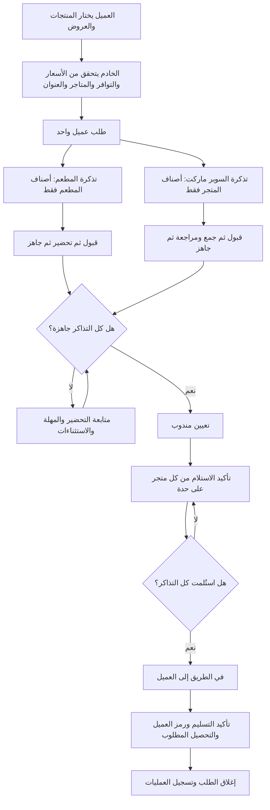

# تصور دورة التشغيل والعرض الديناميكي — الإصدار الثاني

حالة الوثيقة: توزيع الشاشات معتمد. نُفذ الويب وواجهات الخادم مع بوابة تفعيل تدريجي، ولم تتغير ملفات الموبايل. تفاصيل الربط الفعلية والمتطلبات وحدود الدفع في [عقد ربط الموبايل](MOBILE_OPERATIONS_API.ar.md).

## 1. تقسيم الشاشات والمسؤوليات

التوزيع المعتمد: الموبايل للعملاء والشيف ومسؤول تحضير السوبر ماركت والمندوب، والويب للإدارة والإشراف فقط. لا تُنشأ بوابة ويب تشغيلية للتاجر أو المندوب.

تظهر واجهة الموبايل المناسبة وفق حساب المستخدم وصلاحيته ومتجره أو تكليفه، وليس من خلال اختيار دور يمنح صلاحيات. يمكن تنفيذ ذلك داخل التطبيق الحالي؛ لا يتطلب القرار إنشاء تطبيقات مستقلة لكل دور.

| المستخدم | ما يراه | ما ينفذه |
| --- | --- | --- |
| العميل | الأقسام والمتاجر والمنتجات والعروض وتتبع طلبه | يختار الأصناف، يؤكد العنوان والدفع، ويتسلم الطلب |
| شيف المطعم — الموبايل | تذاكر المطعم وأصنافه وكمياتها وإضافاتها وملاحظاتها | يقبل التذكرة، يحضرها، ويعلن جاهزيتها |
| مسؤول تحضير السوبر ماركت — الموبايل | قائمة جمع منتجات متجره، الوحدات والكميات والملاحظات | يجمع الأصناف، يراجعها، ويجهز الأكياس |
| المندوب المكلّف — الموبايل | نقاط الاستلام وأصناف كل متجر، ثم عنوان العميل والمبلغ المطلوب | يؤكد استلام كل نقطة، يبدأ التوصيل، ويؤكد التسليم |
| الإدارة | الطلبات والمتاجر والتحضير والمندوبون والمحتوى التسويقي | تدير الحسابات والتكليفات والاستثناءات والمحتوى |

يمكن لموظفين مختلفين داخل المتجر فتح شاشة المتجر نفسها بحساباتهم. يُسجل منفذ كل تحديث، وتُحسم التحديثات المتزامنة على الخادم. فرز العمل على محطات مستقلة داخل مطعم واحد توسعة لاحقة.

صفحة التحضير في لوحة الويب تظل شاشة إشراف للإدارة على جميع المتاجر. تنفيذ التحضير والاستلام اليومي يتم من الموبايل. حساب التحضير يرتبط بمتجره من الجلسة، ولا يستطيع اختيار متجر آخر لتوسيع صلاحياته. يسمح الويب بإدارة الحسابات وربطها بالمتاجر وتعيين المندوبين ومتابعة الحالات ومعالجة الاستثناءات، مع تسجيل أي تدخل إداري.

## 2. طلب عميل واحد، وتحضير مستقل لكل متجر

نحافظ على إمكانية شراء أصناف من أكثر من متجر، وهي موجودة في نموذج الطلب الحالي. يُنشئ الخادم طلب العميل وتذكرة تحضير مستقلة لكل متجر ضمن عملية ذرية واحدة.

مثال: طلب به وجبة من مطعم وزجاجتا مياه من سوبر ماركت. المطعم يرى الوجبة وإضافاتها؛ السوبر ماركت يرى المياه ووحداتها وكميتها. المندوب يرى نقطتي استلام وقائمة منفصلة لكل نقطة، والعميل يتابع طلبًا واحدًا.

### شاشة التحضير في الموبايل

- عناوين حسب نوع النشاط: «مطبخ المطعم» و«تحضير السوبر ماركت» باستخدام نفس دورة الحالات.
- أعمدة: جديد، قيد التحضير/الجمع، جاهز للاستلام، ثم سجل المستلم.
- التذكرة: رقم الطلب، وقت الوصول والانتظار، الأصناف والكميات والوحدات والإضافات والملاحظات، ومسؤول التحضير.
- في السوبر ماركت تُراجع عناصر القائمة قبل إعلان الجاهزية. تُراجع الأصناف والإضافات في المطعم أيضًا.
- المنتج الناقص أو الطلب المتعذر ينتقل للمراجعة لدى الإدارة؛ لا يتم استبدال صنف أو زيادة السعر دون موافقة العميل.
- لا تتطلب شاشة التحضير كشف رقم العميل وعنوانه التفصيلي أو أصناف متجر آخر.

### شاشة المندوب في الموبايل

- كل طلب مكلّف به، ونقاط الاستلام مرتبة بتوجيه الإدارة في البداية.
- لكل نقطة: اسم المتجر وموقعه وتعليمات الاستلام، حالته، المنتجات والكميات والأكياس أو الطرود، وملاحظات التحضير.
- تأكيد الاستلام منفصل لكل متجر مع الوقت والمنفذ. لا يكفي زر عام «استلمت الطلب» لطلب متعدد المتاجر.
- بعد استلام جميع النقاط يبدأ التوصيل. يظهر عنوان العميل: الوزارة/المبنى، الدور، المكتب، الموقع إن توفر، ووسيلة التواصل.
- يظهر المبلغ المطلوب تحصيله فعليًا. الطلب المدفوع مسبقًا لا يُحصّل نقدًا مرة أخرى.
- إتمام التسليم يتم عبر الخادم ورمز العميل؛ تأكيد الدفع الإلكتروني يعتمد على حالة موثوقة من مزود الدفع.

### حالات الطلب الإجمالية

| الحالة الحالية المتوافقة | معناها في الفلو المقترح |
| --- | --- |
| `received` | الطلب وصل ولم يبدأ التحضير |
| `preparing` | متجر واحد على الأقل بدأ، ولم تجهز جميع التذاكر |
| `ready` | جميع التذاكر جاهزة أو استلمها المندوب جزئيًا |
| `with_courier` | المندوب استلم جميع نقاط الطلب وبدأ التوصيل |
| `delivered` | الخادم أكد التسليم والتحصيل المطلوب |
| `cancelled` | أُغلق بالإلغاء وفق سياسة الإلغاء والتسوية |

تعيين المندوب وحده لا يعني استلام الأصناف. الفلو الحالي يخلط بين التعيين و`with_courier`؛ يُصحح ذلك للطلبات الجديدة دون إعادة تفسير الطلبات التاريخية تلقائيًا.

للبداية يُعيّن مندوب واحد بعد جاهزية جميع المتاجر. قبول المندوب للتكليف، وتقسيم الطلب بين مناديب، والاستلام أثناء استمرار متجر آخر في التحضير توسعات منفصلة.

## 3. العرض الديناميكي داخل تطبيق العميل

عدد المتاجر القليل لا يستدعي إخفاءها نهائيًا أو تثبيت الواجهة في الكود. الإدارة تتحكم في الأقسام التي تظهر وترتيبها:

1. سلايدر الحملات والعروض.
2. المتاجر، مع إمكانية إظهار القسم أو إخفائه.
3. المنتجات المخفضة.
4. المنتجات والتصنيفات والمنتجات المميزة.

يمكن البدء بالمنتجات والعروض في المقدمة، مع شريط صغير للمتاجر. لاحقًا تُقدم المتاجر أو تُغير أولوية الأقسام من الإدارة دون إصدار جديد للموبايل، بعد تنفيذ قارئ الإعدادات في التطبيق.

### إدارة الحملات والسلايدر

- صورة مناسبة للعرض، عنوان مختصر، ترتيب، تفعيل/إيقاف، وموعد بدء وانتهاء.
- هدف واضح عند الضغط: منتج، متجر، أو صفحة العروض. تُستخدم معرفات فعلية، وليس مجرد نص أو صورة بلا رابط.
- وضع تلقائي يختار عروض المنتجات المتاحة، ووضع يدوي لترتيب أو تثبيت حملات مختارة.
- لا يظهر عرض لمنتج مؤرشف أو غير مربوط بمتجر أو غير متاح للطلب. ترتبط أهلية الطلب أيضًا بحالة المتجر.
- السعر والخصم يُقرآن من المنتج الحالي؛ لا تُنسخ أسعار قديمة داخل صورة السلايدر باعتبارها مصدر الحساب.
- إذا لم توجد حملات مؤهلة، يُخفى السلايدر أو تظهر مادة تعريفية واضحة دون ادعاء وجود خصم.
- انتهاء حملة السلايدر يخفي الإعلان؛ لا يعيد تسعير المنتج تلقائيًا. جدولة السعر نفسه تحتاج سياسة وآلية مستقلة.
- تُعرض مواعيد الإدارة بتوقيت القاهرة وتُحفظ التواريخ كطوابع زمنية موحدة.

## 4. عقد البيانات المقترح بين الويب والموبايل

الأسماء التالية مقترحة، وتثبت قبل التنفيذ المشترك. لا تُستبدل الحقول الحالية دون انتقال متوافق.

| المسار | الاستخدام |
| --- | --- |
| `stores/{storeId}` | المتجر ونوع النشاط وحالة استقبال الطلبات ومعلومات نقطة الاستلام |
| `products/{productId}` | منتج مرتبط بمتجر وأسعاره ووحدته وتوافره |
| `orders/{orderId}` | طلب العميل والأسعار المحسوبة وعنوانه وحالته الإجمالية والمندوب |
| `orders/{orderId}/fulfillments/{storeId}` | تذكرة المتجر بأصنافه فقط، حالتها ومسؤول التحضير وتأكيد الاستلام |
| `appConfig/customerHome` | الأقسام المفعلة وترتيبها ووضع السلايدر |
| `promotions/{promotionId}` | محتوى الحملة ومواعيدها وترتيبها ومعرف الهدف |

تُحفظ تفاصيل أصناف الطلب وأسعارها وقت الشراء، فلا تغيرها تعديلات الكتالوج اللاحقة. تذكرة المتجر تعرض نسخته من الأصناف فقط. تقسيم البيانات والصلاحيات يكون على الخادم وقواعد الوصول، وليس مجرد إخفاء بطاقات في الواجهة.

حساب التحضير مرتبط بالمتجر، والعميل بصاحب الطلب، والمندوب بالتكليف. يُسجل الخادم القبول والجاهزية والاستلام والتسليم في سجل التدقيق.

نستخدم علامة إصدار، مثل `fulfillmentVersion: 2`، للطلبات الجديدة. تبقى `storeIds` و`kitchenStatus` والحالات الإجمالية متاحة للتوافق أثناء تحديث الموبايل. قواعد الإغلاق الجديدة لا تُفرض على طلبات قديمة تفتقد تذاكر الاستلام.

## 5. ما هو موجود وما يحتاج تنفيذًا

| الجزء | الموجود حاليًا | المطلوب |
| --- | --- | --- |
| تحضير عدة متاجر | `kitchenStatus` لكل متجر وجاهزية إجمالية | تذاكر مستقلة وشاشة موبايل مقيدة بمتجر الحساب |
| شاشة `/kitchen` على الويب | تدخل عبر بوابة الإدارة | تظل للإشراف؛ شاشة تنفيذ التحضير تكون في الموبايل |
| استلام المندوب | قائمة تحقق عامة مرتبطة بالطلب | تأكيد كل نقطة استلام ومنع بدء التوصيل قبل اكتمالها |
| عرض المتاجر في الموبايل | بيانات المتاجر متصلة بالكتالوج | إعدادات لظهور القسم وترتيبه |
| سلايدر الموبايل | قائمة ثابتة داخل `client_home_screen.dart` | قراءة حملات مؤهلة من البيانات المشتركة |
| عروض المنتجات على الويب | خصم حقيقي مرتبط بالسعر والمتجر والتوافر | مشاركة نفس أهلية العروض مع الموبايل |

## 6. ترتيب التنفيذ المقترح

1. توزيع الشاشات معتمد: التشغيل على الموبايل والإدارة على الويب. تُثبت تفاصيل عقد البيانات المشترك مع مساعد الموبايل.
2. تنفيذ تذاكر المتاجر وصلاحياتها على الخادم، وشاشات التحضير للمطاعم والسوبر ماركت في الموبايل.
3. تنفيذ نقاط استلام المندوب وتأكيداتها في الموبايل وربطها على الخادم بالحالة الإجمالية والتسليم.
4. تنفيذ إدارة واجهة العميل والحملات على الويب، ثم قارئ الإعدادات والسلايدر في الموبايل.
5. اختبار طلب مختلط من مطعم وسوبر ماركت، بما يشمل النقص والتأخير وإلغاء الطلب والتكليف والصلاحيات والدفع.

معيار النجاح: يستطيع موظف كل متجر تحضير أصنافه فقط، ويستلم المندوب جميع نقاط الطلب بتأكيدات منفصلة، ويتابع العميل حالة صحيحة، ويمكن للإدارة تغيير أقسام الواجهة والحملات دون تحديث كود الموبايل بعد دعم الإعدادات الديناميكية فيه.

## 7. تقسيم التنفيذ بين مساعد الويب ومساعد الموبايل

| المسؤولية | مساعد الويب والخادم | مساعد الموبايل |
| --- | --- | --- |
| التحضير | نموذج التذاكر، واجهات التحديث، التحقق من صلاحية المتجر، وشاشة إشراف الإدارة | شاشة شيف المطعم وشاشة جمع منتجات السوبر ماركت |
| المندوب | التكليفات، نقاط الاستلام، التحقق من الاستلام والتسليم، والتدقيق | عرض التكليف ونقاط الاستلام والأصناف وتأكيد كل نقطة والتسليم |
| واجهة العميل | إدارة الأقسام والحملات والعروض والبيانات المشتركة | قراءة الإعدادات وترتيب الأقسام والسلايدر والانتقال للهدف |
| الوصول | إدارة الحسابات والأدوار وربط موظفي التحضير بالمتاجر | إظهار واجهة الدور المصرح به والتعامل مع انتهاء الجلسة أو تغير الصلاحية |

واجهات الويب والخادم متاحة في التحديث؛ توضح وثيقة الربط الفعلية أسماء الإجراءات وشروط التفعيل. لا يُعدّل مساعد الويب ملفات الموبايل، ولا يُفترض أن رفع تعديل ويب يضيف شاشات للموبايل تلقائيًا.
