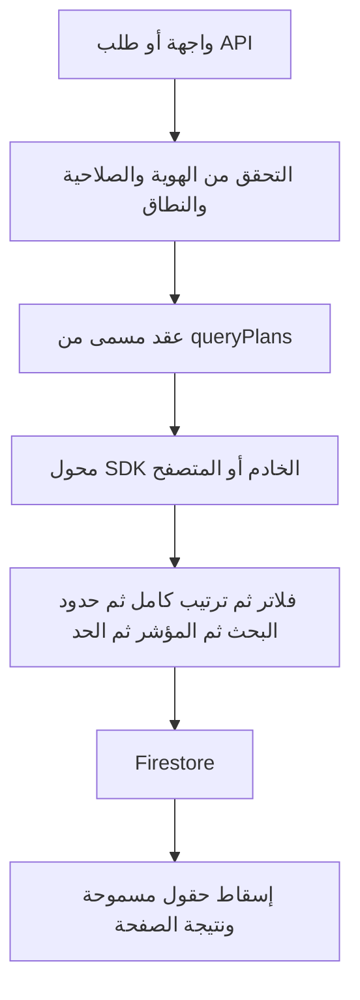
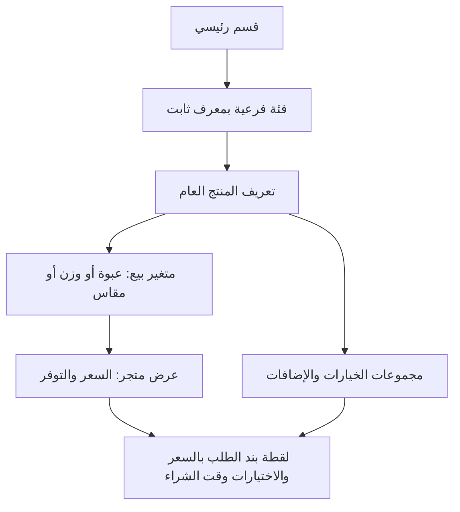

# هيكلة الاستعلامات والكتالوج — 29 أكتوبر 2026

## القرار ونطاق التنفيذ الحالي

الاستعلام جزء من عقد بيانات له نطاق وفهرس وحد قراءة وترقيم صفحات. لا يبنيه كل مكوّن من الصفر. المقاسات تشمل النوعين المعتمدين: متغيرات بيع مستقلة بالسعر والباركود والتوفر، وخيارات/إضافات داخل المنتج.

المنفذ في هذه الدفعة هو أساس القراءة المشترك ونقل المسارات الأساسية إليه، مع سجل صريح للاستعلامات القديمة. ملف `catalogSchemaV2.ts` عقد النموذج المستهدف فقط؛ لم تُرحّل المقاسات أو التصنيفات الحالية أو تُغيّر معرّفات الطلبات والفواتير. لا يُدّعى اكتمال ترحيل كل المشروع.

## المسار الموحد للقراءة

- `src/data/queryPlans.ts`: العقود المسمّاة، النطاق، الفلاتر، الترتيب، حدود البحث وعدد السجلات والفهارس المركبة المطلوبة.
- `server/data/firestoreQueries.ts`: بناء استعلامات Admin SDK وتنفيذها، مع تشخيص خطأ بمفتاح العقد ورمز الخطأ والمدة، دون نص البحث أو المؤشر أو بيانات العميل.
- `src/data/firestoreQueries.ts`: بناء QueryConstraint للمتصفح بالعقود نفسها.
- `tests/query-contracts.test.ts`: إنشاء الاستعلامات على SDK الخادم والمتصفح الفعليين دون شبكة، والتحقق من حدود النطاق وملف الفهارس وفحص CI.
- `scripts/check-query-architecture.mjs`: تحليل AST يمنع زيادة بناة الاستعلامات الخام خارج المحولات. الاستثناءات القديمة مثبتة في `config/query-legacy-baseline.json`؛ لا تتجدد تلقائيًا في CI.

الترتيب المركزي يمنع خطأ `orderBy` بعد `startAt/endAt` من الأساس. العقود داخلية وليست DSL يرسله العميل. قيمة `scope` ليست إذن وصول: تظل المصادقة وقواعد Firestore وإسقاط البيانات مسؤولية الخدمة قبل التنفيذ وبعده. نطاق المتجر والمندوب إلزامي في فلاتر عقودهما.

## المسارات المنقولة فعليًا

| الاستخدام | العقد | الحد |
| --- | --- | --- |
| البحث في التعريف العام والمنتجات القديمة | `catalog.*` | 51 لكل مصدر؛ 50 نتيجة ومؤشر |
| منتجات التاجر | `merchant.products` | 101؛ صفحة 100 |
| تسويات التاجر | `merchant.payments` | 51؛ صفحة 50 |
| ملخص عملاء التاجر | `merchant.customers` | 101 طلب؛ عرض نطاق العينة بوضوح |
| قائمة المتاجر العامة | `shop.stores` | 30، مع مؤشر |
| منتجات متجر العميل | `shop.products` | 25، مع مؤشر |
| منتجات ومتاجر الرئيسية | `home.*` | 60 منتجًا و30 متجرًا |
| شريط المنتجات والمتاجر | `carousel.*` | 24 منتجًا و12 متجرًا |
| الطلبات النشطة والتاريخية للمتجر والمندوب | `portal.orders.*` | 51 للنشط، 21 للسجل |
| فهرس تاريخ العميل | `customer.history` | 30 |
| تسويات الإدارة | `admin.settlements` | 100 |
| سجل الإشعارات | `admin.notifications` | 50 |
| سجل التدقيق بفلاتره وفترته | `admin.audit` | 51؛ صفحة 50 |

حدود العينات الحالية محفوظة، ولا تتحول إلى مجاميع مالية أو نتائج بحث كاملة. كل تحسين مستقبلي للبحث أو الفرز يبدأ بتعديل العقد والفهرس والاختبار، ثم الخدمة والواجهة.

## نموذج الأقسام والأصناف والمقاسات

1. **التصنيف**: `id` ثابت و`parentId` وشجرة واسم عرض قابل للتغيير. لا يكون اسم «مشروبات» هو المفتاح المرجعي. يدعم الشاي فئة فرعية داخل المشروبات، ثم العلامات والمنتجات.
2. **تعريف المنتج**: الهوية والعلامة والوصف والصور والتصنيف. لا يحمل سعر تاجر.
3. **متغير البيع**: عبوة 250 جم و500 جم متغيران بمعرفين وSKU وباركود عند توفره وصورة وصفات محددة؛ التوفر والسعر يختلفان حسب عرض المتجر. قد تكون الصفة «صغير/وسط/كبير» دون قياس وزني.
4. **الخيارات والإضافات**: السكر أو إضافة حليب أو تغليف لها مجموعات واختيارات بمعرفات وحدود اختيار وأسعار إضافية. لا تصبح متغيرات بيع تلقائيًا.
5. **عرض المتجر**: مفتاح فريد من المتجر والمتغير؛ السعر بالقروش الصحيحة وEGP، والإتاحة والأرشفة. إعادة المحاولة لا تنشئ عرضًا ثانيًا.
6. **لقطة الطلب**: معرفات المنتج والمتغير والعرض، وأسماء العرض وSKU والسعر والإضافات والضريبة وقت الشراء. تغيير الكتالوج لا يعيد حساب طلب قديم.

الباركود والهوية وبيانات العبوة هي أساس مراجعة التكرارات. تشابه الاسم لا يثبت التطابق. لا نستنتج تلقائيًا أن كل `optionGroups` الحالية مقاسات، ولا ندمج عبوتين بمجرد وجود كلمة «شاي».

العقد المستهدف موجود في `src/data/catalogSchemaV2.ts`. يبقى نموذج `Product` الحالي والحقول السعرية القديمة فعالين حتى ترحيل متدرج واختبارات التسعير والسلة والموبايل. المخزون الكمي وحجز الكميات يتطلبان دفتر حركات ومعاملات مستقلًا؛ `inStock` ليس عدد القطع.

## البحث والفهارس والتصفح

- البحث الحالي prefix ببداية الاسم؛ لا نعدّه بحثًا في أي كلمة أو تصحيحًا إملائيًا. عند نمو الكتالوج، نضيف فهرس بحث مخصص للمنتج والمتغير والباركود وSKU والتصنيف بدل مسح Firestore كاملًا لكل حرف.
- تطبيع عربي للبحث فقط: الهمزات والتشكيل والمسافات، مع حفظ الاسم الأصلي للعرض؛ لا يُستخدم التطبيع وحده لدمج المنتجات.
- عقد البحث المستهدف: نص، فئة/مسار فئات، صفات المتغير، متجر، إتاحة، ترتيب ومؤشر؛ الفلاتر غير المدعومة تُرفض بدل تجاهلها.
- الفهارس الحالية المطلوبة للطلبات والتدقيق مرتبطة بالعقود، ويختبر CI وجودها في `firestore.indexes.json`. ذلك لا يثبت أنها نُشرت على الإنتاج.
- مؤشرات API الحالية تبقى متوافقة. الإصدار التالي يربط المؤشر بإصدار العقد ومفتاح الاستعلام والنطاق وبصمة الفلاتر والترتيب؛ تغيير الفلاتر يعيد التصفح من البداية.
- اللوحة تقرأ مؤشرات التشغيل النشطة لحظيًا، والسجل على صفحات. التقارير الواسعة تحتاج read models يومية خادمية، لا تنزيل كل الطلبات وتجميعها في المتصفح.

## سجل الترحيل المتبقي

الملفات القديمة مسجلة آليًا في baseline؛ وجودها لا يعني أنها جميعًا واجهات قراءة عادية:

| المجموعة | الخطر أو سبب فصل ترحيلها |
| --- | --- |
| `customerOrders` | فهرسة الطلبات القديمة أول مرة تقرأ تاريخ الحساب؛ تُنقل إلى مهمة checkpoint على صفحات قبل أحجام كبيرة |
| `admin-users` وكتابات `admin-data` | استعلامات داخل معاملات تغيير الأدوار وربط الموظفين؛ لا يجوز وضع حد عشوائي قد يُخفي طلبًا نشطًا ويتجاوز حماية الحساب |
| `geidea/callback` | استعلامات مطابقة الدفع وحماية التكرار؛ تحتاج اختبارات مزود الدفع والمعاملات قبل تعديلها |
| `notifications` | fan-out للمستلمين يحتاج دفعات ومؤشرات ومفاتيح منع التكرار |
| `app-content` و`PublicOffers` | فحص عروض من المنتجات واشتراكات قديمة؛ يُستبدل بفهرس عروض/read model بصفحات، مع تعريف اكتمال النتائج |
| `operations` و`merchantActions` القديمة و`sangoubRequests` | قوائم تشغيل وسجل قديم تُرحّل بعقود خاصة دون تغيير انتقالات الطلبات |
| `useActivePortalOrders` | اشتراكات إشارات مقيدة بالفعل؛ توحيد lifecycle وإعادة الاتصال دون مضاعفة الاشتراكات |
| `ShopContext` | قراءة مجموعة معرفات السلة على دفعات؛ الحفاظ على ترتيب المطابقة وعدم إحياء وحدات محذوفة |
| `watchCollection` | واجهة توافق للقراءات القديمة؛ العقود الجديدة مدعومة حاليًا، وتُزال قوائم القيود الحرة تدريجيًا |

لا تُعدّل baseline لتمرير إضافة استعلام جديد عشوائي. أي استثناء جديد يحتاج وصف نطاقه وحده وفهرسه واختباره في المراجعة. فحص CI يحد الزيادة في البناة القديمة؛ لا يحل محل مراجعة الصلاحيات.

## مراحل التنفيذ التالية

1. مراجعة تعيين المنتجات الحالية إلى فئات ومعرّفات ومتغيرات من بيانات العبوة والباركود، مع تقرير تعارضات قبل الكتابة.
2. ترحيل تجريبي على متجر واحد بمؤشرات تقدم ومفاتيح منع التكرار، وإبقاء معرفات عروض `products` القديمة كطبقة توافق للويب والموبايل.
3. تفعيل قراءة المتغيرات في الكتالوج والسلة والتسعير الخادمي، واختبار المقاسات المستقلة والإضافات معًا. تُحفظ اللقطات القديمة دون تعديل.
4. استبدال البحث القديم وفهرسة العروض والتقارير، ثم إزالة استثناءات baseline مجموعة بعد أخرى.
5. توسيع الترحيل بعد اختبارات Firebase والفهارس والنطاق المالي، مع إمكانية الرجوع إلى القراءة القديمة دون حذف بيانات.

لم تُنفذ هذه الدفعة ترحيل بيانات الإنتاج أو نشر فهارس أو قواعد Firestore. اختبار SDK دون شبكة يكشف أخطاء بناء الاستعلام، واختبار الفهارس يفحص الملف فقط؛ التحقق من صلاحيات الإنتاج ودقة بياناته مرحلة منفصلة.
